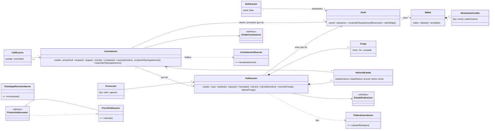

# SkillSwap — Backend (TP Procesos de Desarrollo de Software, UADE)

Marketplace de talento, mentorías y proyectos. Java 17, Clean Architecture, Hibernate/JPA + MySQL, Flyway, JUnit 5. **Sin Spring.**
Los profesionales publican mentorías o servicios, las organizaciones publican desafíos y todo se paga con créditos ficticios (**SkillCoins**).

> **Leé esto primero (estado honesto de la verificación).**
> En el entorno donde se generó este proyecto Maven Central estaba bloqueado, así que **nunca se corrió `mvn verify`** ni se ejecutó nada contra Hibernate, H2, Flyway o MySQL reales.
> Lo que sí se verificó: todo el código **compila** (JDK 17) contra stubs de la API de `jakarta.persistence`/Flyway/slf4j, y **481 tests** (dominio, aplicación, adapters, los 10 casos de aceptación en memoria) **pasan** con un runner de JUnit casero.
> Lo que **no** se pudo ejecutar: los 86 tests JPA (`infrastructure/persistence/jpa/**`) y los 22 tests de aceptación sobre JPA/H2 (`acceptance/jpa/**`), el arranque de Flyway (`V1__esquema.sql`), el `hbm2ddl=validate` y todas las consultas JPQL.
> **Tu primer paso es correr `mvn verify` en tu máquina** (sección 2). Si algo del mapeo JPA falla, es esperable: la sección 9 lista los puntos de riesgo y dónde mirar.

---

## 1. Qué hay en la carpeta

```
skillswap/
├── pom.xml                      Java 17 · Hibernate 6.5.2 · MySQL 9.0.0 · Flyway 10.17 · H2 2.2 · JUnit 5.10 · JaCoCo
├── README.md                    este archivo
├── docs/CONTRATO_TECNICO.md     reglas de trabajo entre paquetes (útil si seguís con varios agentes)
└── src/
    ├── main/java/com/uade/skillswap/
    │   ├── domain/              entidades, VOs, State, Observer (interfaces + evento), historial
    │   ├── application/         casos de uso (port/in), puertos de salida y repositorios (port/out), Strategy (politica, recomendacion),
    │   │                        Decorator de precio (precio), commands, DTOs, servicios
    │   ├── infrastructure/      JPA + Flyway, adapters (identidad, email, push, interna), factory de canales, reloj
    │   ├── presentation/        controllers delgados + interfaces I*Controller + Resultado/ManejadorErrores + menú de consola
    │   ├── bootstrap/           Composicion (compositor a mano), DatosDemo, DemoFlujoPrincipal
    │   └── Main.java
    ├── main/resources/          META-INF/persistence.xml · db/migration/V1__esquema.sql
    └── test/java/               domain · application · infrastructure · acceptance (memoria y jpa) · support (fakes)
```

Números: 215 clases de producción, 83 de test, ~10.6 mil líneas de código y ~12.3 mil de tests.

---

## 2. Cómo ejecutar

Requisitos: JDK 17+, Maven 3.9+. MySQL 8/9 **solo** si querés correr contra MySQL (para todo lo demás alcanza H2 en memoria).

```bash
mvn verify                                  # compila, corre TODOS los tests (incluye JPA/H2 y aceptación) y genera cobertura JaCoCo
open target/site/jacoco/index.html          # cobertura (meta sugerida de la consigna: 80 % en dominio y aplicación)

mvn exec:java -Dexec.args="--h2"            # demo completa sobre H2 en memoria (no necesita MySQL)
mvn exec:java -Dexec.args="--h2 --menu"     # demo y después menú de consola (login por userId: u-ana, u-bruno, u-cecilia, u-techcorp)
mvn exec:java -Dexec.args="--sin-demo --menu"
```

**MySQL real:**

```bash
export SKILLSWAP_DB_URL="jdbc:mysql://localhost:3306/skillswap?createDatabaseIfNotExist=true&serverTimezone=UTC"
export SKILLSWAP_DB_USER=root
export SKILLSWAP_DB_PASSWORD=tu_clave
mvn exec:java -Dexec.args="--mysql"
```

Flyway crea/actualiza el esquema al arrancar. Hibernate corre con `hbm2ddl=validate` (nunca `create`/`update`). Con `SKILLSWAP_SHOW_SQL=true` se imprimen las sentencias.
La demo no es repetible sobre la misma base MySQL (los saldos y cupos ya fueron consumidos); para repetirla usá `--h2` o una base nueva.

**Qué imprime la demo** (`DemoFlujoPrincipal`): publicar → solicitar → aceptar → pagar → iniciar → completar → calificar, mostrando actor, estado y saldos de cada paso; una cancelación con reintegro parcial (reintegro + compensación al proveedor); un pago con saldo insuficiente como error controlado; y reputación final.

---

## 3. Arquitectura (Clean Architecture)

```
presentation ──▶ application (port/in) ──▶ domain ◀── application (port/out) ◀── infrastructure
   controllers      casos de uso            reglas        puertos                   JPA, adapters
```

| Capa | Contiene | No conoce |
|---|---|---|
| **Dominio** | `Perfil`, `Publicacion`+`Franja`, `Contratacion`, `Wallet`+`MovimientoCredito`, `Calificacion`, `Notificacion`, `Promocion`, VOs (`SkillCoins`, `Puntaje`, `Habilidad`, `RangoPrecio`, `BloqueDisponibilidad`), State, Observer (`ContratacionObserver`, `ContratacionEvent`), `HistorialEstado` | UI, JPA, MySQL, SDKs |
| **Aplicación** | 9 casos de uso (`port/in`), commands y DTOs, servicios, puertos de salida y repositorios (`port/out`: `IdentidadPort`, `TransaccionPort`, `RelojPort`, `CanalNotificacionPort`, `CanalNotificacionFactory`, `*Repository`), Strategy (`application.politica`, `application.recomendacion`), Decorator de precio (`application.precio`), `NotificadorObserver` | Controllers concretos, SDKs externos, JPA |
| **Infraestructura** | `JpaContexto`, `BaseDeDatos`, `JpaTransaccionAdapter`, entidades `*JpaEntity` + mappers + 7 repositorios JPA, `IdentidadMockAdapter`, `Email/Push/InternaCanalAdapter`, `CanalNotificacionFactoryImpl`, `RelojSistema`, Flyway | Decisiones de negocio |
| **Presentación** | 8 interfaces `I*Controller` y sus implementaciones, `Resultado<T>`, `ManejadorErrores`, `MenuConsola` | Persistencia y reglas de negocio |

Reglas que se respetan (y que podés verificar con un `grep` de imports): `domain` no importa nada de las otras capas ni `jakarta.persistence`; `application` solo importa `domain`; `presentation` solo usa `port/in`, DTOs, commands, `domain.query` y enums; el compositor `bootstrap/Composicion` es el único lugar que conoce todas las capas.

**Diseño clave:**

- **Agregados por id.** Dominio puro (POJOs). La persistencia usa entidades `*JpaEntity` y mappers que rehidratan con los `reconstruir(...)` del dominio. El dominio no tiene setters públicos de reputación, estado ni saldo.
- **Escrow.** `pagar` debita al cliente y el monto queda retenido en la contratación; `completar` acredita al proveedor; `cancelar` reintegra según la política y el resto compensa al proveedor. Si cancela el proveedor, el cliente recupera el 100 %.
- **Reserva dentro de `Contratacion`** (franjaId + `Publicacion.reservarFranja/liberarFranja/reprogramarReserva`), sin entidad `Reserva` aparte.
- **Reprogramación** = propuesta pendiente en la contratación que la contraparte acepta o rechaza; al aceptar se mueve la reserva sin alterar el cupo.
- **Permisos.** Todo caso de uso recibe `actorId`; los controllers lo obtienen de `SesionUseCase` (que sale de `IdentidadPort`). Los servicios validan autor/cliente/proveedor/participante con `NoAutorizadoException`.
- **Errores uniformes.** Los controllers nunca lanzan: devuelven `Resultado<T>` con `ErrorCode` (`VALIDACION`, `NO_ENCONTRADO`, `NO_AUTORIZADO`, `REGLA_DE_NEGOCIO`, `TRANSICION_INVALIDA`, `SALDO_INSUFICIENTE`, `CUPO_AGOTADO`, `FRANJA_NO_DISPONIBLE`, `CONFLICTO_CONCURRENCIA`, `ERROR_INTERNO`).

### Diagrama de clases (Mermaid, para importar en StarUML o usar de guía)



Notas de importación a StarUML (aprendidas con el diagrama del Envío): poner multiplicidades en ambos extremos, las interfaces con *Stereotype Display = Icon*, evitar genéricos de varios parámetros, y armar a mano los paquetes de capas.

---

## 4. Patrones de diseño (6 + 1; la consigna pide mínimo 4)

| Patrón | Dónde | Variación que resuelve | Evidencia (tests) |
|---|---|---|---|
| **State** | `publicacion/estado/*` (5 estados), `contratacion/estado/*` (7 estados) + `EstadoXFactory.desdeNombre` | Qué acciones son válidas en cada estado; las inválidas lanzan `TransicionInvalidaException` | `PublicacionTest`, `FranjaYEstadosTest`, `ContratacionTest`, casos 2, 3, 5 |
| **Strategy** | `PoliticaCancelacion` (`Flexible` 100/50/0 con 24 h/2 h; `Estricta` con 72 h/48 h) y `EstrategiaRecomendacion` (`Afinidad`, `Popularidad`) | Cálculo de reintegro y de recomendación intercambiables | `PoliticaCancelacionTest`, `RecomendacionTest`, casos 6 y 7 |
| **Decorator** | `PrecioPublicacion` → `PrecioBase` → `PromocionPorcentaje` / `PromocionMontoFijo` | Promociones acumulables; cada una descuenta sobre el resultado anterior y el total se acota en 0 | `PrecioPublicacionTest`, caso 9 |
| **Observer** | `Contratacion` (Subject) acumula eventos; `NotificadorObserver` los atiende **después del commit** | Notificar a las partes sin acoplar el dominio a email/push | `NotificadorObserverTest`, caso 8 |
| **Adapter** | `IdentidadMockAdapter` → `ServicioIdentidadExterno`; `Email/PushCanalAdapter` → `EmailSdkMock`/`PushSdkMock` | Proveedores externos con API propia detrás de puertos de la aplicación | `IdentidadMockAdapterTest`, `CanalesNotificacionTest`, caso 8 |
| **Simple Factory** | `CanalNotificacionFactoryImpl`, `PoliticaCancelacionFactory`, `EstrategiaRecomendacionFactory`, `PrecioPublicacionFactory`, `EstadoXFactory` | Elegir canal/estrategia/estado a partir de un valor (preferencia del usuario, texto persistido) | `CanalesNotificacionTest` |
| **Facade** | `PerfilService.verPerfilPublico` | Vista resumida del perfil (datos + reputación + últimas calificaciones + publicaciones activas) | `PerfilServiceTest` |

Descartados a propósito (justificar en el informe): **Composite** (no hay jerarquía real de categorías en el alcance), **Singleton** (no hace falta una única instancia; el compositor arma todo explícitamente).

---

## 5. Persistencia, transacciones y concurrencia

- **Esquema:** `db/migration/V1__esquema.sql` (16 tablas, portable MySQL 8 / H2 en modo MySQL). Únicos: `perfil.user_id`, `calificacion(contratacion_id, autor_id)`. Índices: `publicacion(estado, categoria, precio_base)`, historiales, `notificacion(destinatario_id, leida)`. Sin `ddl-auto=create`.
- **Mapeo:** estado como `String`; el objeto State se reconstruye con `EstadoXFactory.desdeNombre` (equivale al `@Transient + @PostLoad` del ejemplo del curso). Historial **append-only** (se insertan solo entradas nuevas). Colecciones con `@ElementCollection` / entidades hijas.
- **Transacciones:** `TransaccionPort.ejecutar(...)` implementado por `JpaTransaccionAdapter` (reentrante, un `EntityManager` por unidad de trabajo vía `JpaContexto`). Cada operación mutante de un servicio corre en **una** transacción: aceptar (estado + franja/cupo), pagar (débito + estado), completar (acreditación + estado), cancelar (estado + franja + reintegro + compensación). Las notificaciones salen después del commit y en su propia transacción; si un canal falla no se deshace la operación.
- **Concurrencia:** `@Version` en Perfil, Publicacion, Contratacion y Wallet, más un chequeo de versión previo al guardado; los conflictos se traducen a `ConflictoConcurrenciaException`. Al reprogramar una reserva sube `publicacion.revision` para que el `@Version` detecte el cambio de franjas.
- **Sin N+1 / paginación:** todos los listados son paginados (`PaginaRequest`, tamaño máximo 100). La búsqueda hace `count` + ids paginados + una consulta `JOIN FETCH` por colección (nunca `JOIN FETCH` con `setMaxResults`; `hibernate.query.fail_on_pagination_over_collection_fetch=true` lo hace fallar fuerte si alguien lo reintroduce). Autores y promociones se cargan **por lote** (`buscarPorIds`, `buscarActivasPorPublicaciones`). Hay un test que verifica una sola consulta de autores y de promociones por página.
- **Datos de demostración:** `DatosDemo` (idempotente, vía casos de uso, fechas relativas a "ahora"); no hay seed en SQL porque las franjas deben ser futuras.

---

## 6. Matriz de la consigna (secciones 4.1 a 15)

Estado: ✅ implementado y verificado con el arnés local · 🟡 implementado pero **no ejecutado** contra JPA/MySQL reales · ⬜ pendiente (no se puede hacer desde el código).

| Sec. | Requisito | Estado | Dónde / evidencia | Qué te toca hacer |
|---|---|---|---|---|
| 4.1 | Registrar perfil con `userId` de identidad externa | ✅ | `PerfilService.registrar`, `IdentidadPort` | Nada; explicalo en la defensa |
| 4.1 | Nombre, bio, zona horaria, habilidades, intereses, disponibilidad | ✅ | `Perfil.actualizarDatos`, `ActualizarPerfilCommand` | — |
| 4.1 | Perfil público con reputación, publicaciones activas e **historial resumido** | ✅ (interpretación) | `PerfilPublicoDto`: reputación + últimas calificaciones + publicaciones activas | Decidir si "historial resumido" exige también contrataciones completadas; si sí, sumar contador (necesita `ContratacionRepository` en `PerfilService`) |
| 4.1 | Reputación recalculada desde calificaciones verificadas, no editable | ✅ | `Perfil.recalcularReputacion` (sin setter), `CalificacionService` | — |
| 4.2 | Mentoría/servicio (profesional) y desafío (organización) con todos los campos | ✅ | `Publicacion.crearBorrador`, `TipoPerfil` | — |
| 4.2 | 5 estados + transiciones inválidas rechazadas + publicar exige título, categoría, precio ≥ 0 y franja | ✅ | `publicacion/estado/*`, `validarCompletaParaPublicar` | — |
| 4.3 | Buscar por texto, categoría, modalidad, rango de precio, habilidad, reputación mínima | ✅ / 🟡 | `FiltroBusqueda`; JPQL en `JpaPublicacionRepository` (🟡) | Correr `JpaBusquedaPublicacionTest` |
| 4.3 | Ordenar por relevancia, reputación, menor precio, más reciente | ✅ / 🟡 | `CriterioOrden` (`RELEVANCIA`, `REPUTACION`, `PRECIO_ASC`, `PRECIO_DESC`, `RECIENTES`) | Definir si querés una relevancia más rica (hoy: título > reputación > fecha) |
| 4.3 | ≥ 2 estrategias de recomendación intercambiables | ✅ | `RecomendacionPorAfinidad`, `RecomendacionPorPopularidad` | "Popularidad reciente": hoy usa cupo ocupado + reputación; evaluar si agregar ventana temporal |
| 4.3 | Paginar todos los listados | ✅ | `Pagina`/`PaginaRequest` en cada listado | — |
| 4.4 | Solicitar, aceptar/rechazar (reserva + cupo transaccional), pagar sin saldo negativo ni doble cobro | ✅ / 🟡 | `ContratacionService`, `Wallet`, casos 3, 4, 5 | Correr casos 3-5 sobre JPA |
| 4.4 | Reprogramar antes de comenzar si ambas partes aceptan | ✅ | `proponerReprogramacion`/`responderReprogramacion` | — |
| 4.4 | Calificación por cada parte, nadie se califica a sí mismo | ✅ | `Calificacion.registrar`, caso 10 | — |
| 4.5 | Tabla de estados de contratación | ✅ | `contratacion/estado/*` | — |
| 4.6 | Notificar los 6 eventos; email/push/interna por usuario; proveedores simulados detrás de interfaces | ✅ | `NotificadorObserver`, adapters, factory | — |
| 5 | Reglas mínimas (autor no solicita lo propio, publicación no publicada no admite solicitudes, franja/cupo, débito+crédito atómico, reintegro 100/50/0, promociones sin total negativo, calificar una vez, historial inmutable, baja lógica, permisos) | ✅ | tests por regla en `domain/**` y `application/**` | — |
| 6 | Clean Architecture con la separación pedida | ✅ | sección 3 | Dibujar el diagrama de capas en el informe |
| 7 | ≥ 4 patrones, justificados y con pruebas | ✅ | sección 4 | Escribir la justificación en el informe (problema, alternativa, consecuencias, evidencia) |
| 8 | Persistir todas las entidades pedidas, unicidad e índices | 🟡 | `V1__esquema.sql`, entidades | Correr `mvn verify` y mirar `hbm2ddl=validate` |
| 8 | Migraciones Flyway, sin `create` | 🟡 | `BaseDeDatos`, `V1__esquema.sql` | Idem |
| 8 | Límites transaccionales | ✅ / 🟡 | sección 5 | — |
| 8 | Evitar N+1 y justificar fetch plans | ✅ / 🟡 | sección 5 | Justificarlo en el informe; opcional: test que cuente sentencias SQL |
| 8 | Datos de demostración reproducibles | ✅ / 🟡 | `DatosDemo`, `Main --h2` | — |
| 8 | Optimistic locking contra sobreventa | 🟡 | `@Version`, caso 4 JPA (concurrente) | Correr `Caso04UltimoCupoJpaTest`; es el test más sensible a H2 |
| 9 | Controllers delgados, errores uniformes, sin SQL ni reglas | ✅ | `presentation/controller/*`, `Resultado` | Ver nota de nombres abajo |
| 10 | Mock UI Kit conectado por interfaces | ⬜ | `I*Controller` son el contrato | **Pedir el Mock UI Kit a la cátedra** y ajustar las firmas de las interfaces a las suyas (es lo único que probablemente cambie) |
| 11 | Entregas incrementales | ⬜ | — | Planificar con el equipo |
| 12 | Pruebas: dominio, estrategias, casos de uso con fakes, persistencia, integración, negativos | ✅ / 🟡 | 481 tests locales + 108 JPA/H2 sin ejecutar | `mvn verify`; revisar JaCoCo (meta 80 %) |
| 12 | README reproducible | ✅ | este archivo | Ajustarlo si cambian comandos |
| 13 | Diagrama de clases en StarUML | ⬜ | Mermaid de la sección 3 como base | Armarlo en StarUML con multiplicidades y patrones marcados |
| 13 | Informe PDF de decisiones | ⬜ | secciones 3-5 y 8 de este README como insumo | Escribirlo (problema, alternativa, consecuencias, evidencia) |
| 13 | Demo en vivo del recorrido principal | ✅ / 🟡 | `mvn exec:java -Dexec.args="--h2"` | Ensayarla |
| 15 | **10 casos de aceptación** | ✅ memoria / 🟡 JPA | `acceptance/memoria/Caso01…Caso10`, `acceptance/jpa/Caso01…Caso10…JpaTest` | Correr ambos juegos |

Nota de nombres (sección 9 de la consigna): los controllers usan `registrar` (≈ `crearPerfil`), `miPerfil`/`verPerfilPublico(id)` (≈ `verPerfil`) y `cambiarEstado(id, AccionPublicacion, motivo)` además de `publicar/pausar/...`. Son orientativos; se alinean cuando llegue el Mock UI Kit.

### Los 10 casos de aceptación (sec. 15)

| # | Caso | Test en memoria |
|---|---|---|
| 1 | Publicar mentoría válida y encontrarla con búsqueda filtrada | `Caso01PublicarYBuscarTest` |
| 2 | Rechazar la publicación de una oferta incompleta | `Caso02OfertaIncompletaTest` |
| 3 | Solicitar, aceptar y pagar con saldo suficiente | `Caso03SolicitarAceptarYPagarTest` |
| 4 | Evitar que dos aceptaciones consuman el último cupo | `Caso04UltimoCupoTest` (+ versión concurrente en JPA) |
| 5 | Rechazar un pago con saldo insuficiente sin modificar saldos ni estado | `Caso05SaldoInsuficienteTest` |
| 6 | Cancelar y calcular el reintegro con dos políticas | `Caso06CancelacionConDosPoliticasTest` (60 h, precio 80: flexible 80, estricta 40) |
| 7 | Cambiar la estrategia de recomendación sin tocar el caso de uso consumidor | `Caso07CambiarEstrategiaRecomendacionTest` |
| 8 | Dos tipos de notificación ante un mismo evento (adapters mock) | `Caso08DosNotificacionesPorEventoTest` |
| 9 | Promociones acumulables sin precio negativo | `Caso09PromocionesAcumulablesTest` |
| 10 | Completar, calificar una sola vez y recalcular reputación | `Caso10CompletarCalificarYReputacionTest` |

---

## 7. Trabajo repartido (para varios agentes o para el equipo)

El proyecto se armó contract-first: `domain` + `application/port|command|dto|exception|config` son el contrato; cada paquete de trabajo escribe solo su carpeta. Reglas y constructores exactos en `docs/CONTRATO_TECNICO.md`.

| Paquete | Carpeta(s) | Estado | Próximas tareas |
|---|---|---|---|
| **A — Servicios** | `application/service`, `application/notificacion`, `application/mapper` | ✅ | Decidir los huecos de la sección 8 (publicación cancelada con contrataciones activas, retiro de solicitud pendiente) |
| **B — Persistencia** | `infrastructure/persistence/**`, `persistence.xml`, `db/migration` | 🟡 sin ejecutar | Correr tests JPA, corregir mapeo/SQL si `validate` falla, test que cuente sentencias SQL |
| **C — Presentación y demo** | `presentation/**`, `bootstrap/**`, `Main` | ✅ / 🟡 | Conectar el Mock UI Kit, ajustar firmas `I*Controller` |
| **D — Adapters y soporte de tests** | `infrastructure/{identidad,notificacion,time}`, `src/test/.../support` | ✅ | Agregar rollback simulado a `TransaccionSimulada` si querés que los fakes reflejen JPA |
| **E — Tests de aplicación** | `src/test/.../application` | ✅ | Subir cobertura según JaCoCo |
| **F — Aceptación** | `src/test/.../acceptance` | ✅ memoria / 🟡 JPA | Ejecutar y ajustar `Caso04UltimoCupoJpaTest` (concurrencia) |
| **G — UML (StarUML)** | fuera del código | ⬜ | Diagrama de dominio + aplicación con multiplicidades y patrones marcados |
| **H — Informe PDF** | fuera del código | ⬜ | Por decisión: problema, alternativa, consecuencias, evidencia (código/tests) |
| **I — Defensa** | — | ⬜ | Cada integrante elige una parte (p. ej. State, persistencia, Observer, Decorator, controllers) y practica modificarla en vivo |

Para seguir con agentes, un prompt útil por paquete: *"Leé `docs/CONTRATO_TECNICO.md` y el README. Trabajá solo en `<carpeta>`. Tarea: `<tarea>`. Verificá con `mvn verify`."*

---

## 8. Decisiones abiertas y límites conocidos

Cosas que dejé decididas de una forma razonable pero que podés querer cambiar, y huecos que conviene mencionar (o cerrar) antes de la defensa:

1. **Escrow vs transferencia directa.** Elegí escrow (el monto queda retenido hasta completar). Alternativa: acreditar al proveedor al pagar.
2. **Reserva sin entidad propia.** Vive dentro de `Contratacion`. Si la cátedra espera una tabla `reserva`, se extrae.
3. **Organización como `TipoPerfil.ORGANIZACION`.** No hay entidad aparte; solo ellas publican desafíos.
4. **Política de cancelación por publicación** (enum persistido) con umbrales globales configurables en `SkillSwapConfig`/`ConfiguracionCancelacion`. Nota: `ContratacionService` tiene un segundo constructor con `PoliticaCancelacionFactory`; el compositor hoy usa el de umbrales por defecto.
5. **Cancelar o cerrar una publicación no toca sus contrataciones activas** (con dinero retenido): no hay reintegro automático. Lo mismo al dar de baja un perfil (aunque sí pausa sus publicaciones publicadas). Propuesta: impedir cancelar/cerrar con contrataciones ACEPTADA/CONFIRMADA/EN_CURSO, o cancelarlas en cascada con reintegro total.
6. **El cliente no puede retirar una solicitud PENDIENTE** (el dominio solo permite al proveedor rechazar).
7. **El cupo no se libera al completar** (cupo = capacidad total de la publicación).
8. **Solicitar la propia publicación** lanza `ReglaDeNegocioException` (regla del dominio), no `NoAutorizadoException`.
9. **Fakes sin rollback.** `TransaccionSimulada` no revierte: en los tests en memoria, un fallo a mitad de `aceptar`/`reprogramar` puede dejar mutado el objeto en memoria. Con JPA la transacción hace rollback y se recarga el agregado, así que no pasa. Los tests en memoria no dependen de eso.
10. **Disponibilidad en la búsqueda:** el fake y el JPA definen "franja libre con inicio ≥ desde y fin ≤ hasta"; la consigna no lo precisa.
11. **Mock UI Kit no disponible** en la carpeta: las interfaces de controllers son propias.
12. **Comisiones** (Decorator de comisión de plataforma) y **Composite de categorías** quedaron fuera a propósito.

---

## 9. Riesgos del runtime JPA (para cuando corras `mvn verify`)

Todo esto se escribió y se type-checkeó pero nunca se ejecutó. Si algo falla, mirá en este orden:

1. **Arranque (`hbm2ddl=validate`)**: tipos `DECIMAL`/`DOUBLE`/`TIME` y `BOOLEAN` (`TINYINT(1)`) entre `V1__esquema.sql` y las entidades. Hay un contraste de columnas/tipos hecho con script, pero no contra Hibernate.
2. **H2 en modo MySQL + Flyway**: si no migra, probar agregar `DATABASE_TO_LOWER=TRUE` a la URL de `BaseDeDatos.iniciarH2()`.
3. **HQL de colecciones básicas**: `join ph.habilidades h where h = :x`, `lower(...)` sobre el alias del elemento y `escape '!'` en `JpaPublicacionRepository` son los puntos más dudosos de Hibernate 6.5. También el orden `RELEVANCIA` (`case when ... like :texto`).
4. **`autor`** como `@ManyToOne` de solo lectura sobre `autor_id` (usado en `join p.autor a` para reputación y orden).
5. **Tests de unicidad y FK** esperan `PersistenceException`; si Hibernate lanza otra subclase, ajustar el `assertThrows`.
6. **"Guardar sin cambios no incrementa la versión"** depende de que el dirty-checking no vea cambios espurios (las fechas se truncan a microsegundos antes de escribir para evitarlo).
7. **Concurrencia con hilos** (`Caso04UltimoCupoJpaTest`, test de wallet): asume `READ_COMMITTED` en H2; un `ERROR_INTERNO` por timeout de lock haría fallar el test.
8. **Flyway 10 con H2**: si pide un módulo de base de datos adicional, agregar la dependencia correspondiente al `pom.xml`.

Cualquier ajuste debería quedar contenido en `infrastructure/persistence/**` y `db/migration/**`: el resto del sistema no se entera del motor.

---

## 10. Guía rápida para la defensa

- **Recorrido principal** (sec. 13): `mvn exec:java -Dexec.args="--h2"` y mostrar cada paso con su estado y saldos.
- **"¿Dónde está la regla X?"** → casi siempre en el dominio (Information Expert): `Contratacion`/`Publicacion` deciden transiciones, `Wallet` decide saldos, `Calificacion.registrar` decide quién puede calificar. Los servicios solo orquestan.
- **"¿Cómo evitás la sobreventa?"** → `Publicacion.reservarFranja` (franja ocupada / cupo) + `@Version` + transacción única en `aceptar`; caso 4.
- **"¿Cómo agrego un canal de notificación nuevo?"** → una clase que implementa `CanalNotificacionPort` + una línea en `CanalNotificacionFactoryImpl` + valor en el enum `CanalNotificacion`. No se toca el dominio ni los servicios.
- **"¿Cómo agrego una política/estrategia/promoción?"** → implementar la interfaz y registrarla en su factory.
- **"¿Por qué no hay Composite/Singleton?"** → sección 4.
