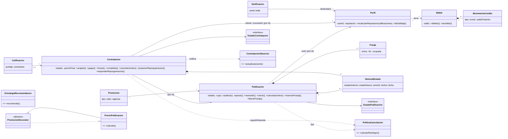

# SkillSwap — Backend (TP Procesos de Desarrollo de Software, UADE)

Marketplace de talento, mentorías y proyectos. Java 17, Clean Architecture, Hibernate/JPA + MySQL, Flyway, JUnit 5. **Sin Spring.**
Los profesionales publican mentorías o servicios, las organizaciones publican desafíos y todo se paga con créditos ficticios (**SkillCoins**).

## Estado

`mvnw verify` pasa completo: **669 tests, 0 fallos** (JDK 17+, base H2 en memoria en modo MySQL). Incluye el arranque de Flyway (`V1__esquema.sql`), el `hbm2ddl=validate` de Hibernate y todas las consultas JPQL.

| Grupo de tests | Carpeta | Tests |
|---|---|---|
| Dominio | `domain/**` | 202 |
| Aplicación | `application/**` | 211 |
| Adapters, reloj y fakes | `infrastructure/{identidad,notificacion,time}/**`, `support/**` | 47 |
| Persistencia JPA | `infrastructure/persistence/jpa/**` | 85 |
| Controllers: integración sobre JPA/H2 y `ValidadorEntrada` | `presentation/controller/**` | 68 |
| Aceptación en memoria | `acceptance/memoria/**` | 34 |
| Aceptación sobre JPA/H2 | `acceptance/jpa/**` | 22 |

Cobertura de JaCoCo por capa (meta de la consigna: 80 % en dominio y aplicación):

| Capa | Líneas | Ramas |
|---|---|---|
| `domain` | 99,4 % | 96,2 % |
| `application` | 99,6 % | 92,4 % |
| `infrastructure` | 93,2 % | 86,2 % |
| `presentation` | 72,7 % | 56,2 % |
| ↳ `presentation.controller` | 100,0 % | 97,4 % |
| `bootstrap` y `Main` | 15,6 % | 0,0 % |
| **Total** | **85,4 %** | **80,9 %** |

Los controllers tienen tests de integración contra H2 (`presentation/controller/**`). El resto de `presentation` (menú de consola y formato) y `bootstrap` se ejercitan con la demo (sección 2). El camino contra MySQL real (`--mysql`) no forma parte de `verify`.

---

## 1. Qué hay en la carpeta

```
skillswap/
├── pom.xml                      Java 17 · Hibernate 6.5.2 · MySQL 9.0.0 · Flyway 10.17 · H2 2.2 · JUnit 5.10 · JaCoCo
├── README.md                    este archivo
├── mvnw, mvnw.cmd, .mvn/        Maven Wrapper (descarga Maven 3.9.16; no hace falta tener Maven instalado)
├── Diagrama UML.mdj             diagrama de clases (StarUML)
├── Informe_SkillSwap.pdf        informe de decisiones de diseño
└── src/
    ├── main/java/com/uade/skillswap/
    │   ├── domain/              entidades, VOs, State, Observer (interfaces + evento), historial,
    │   │                        Strategy de cancelacion (model/politica), Decorator de precio (model/precio)
    │   ├── application/         casos de uso (port/in), puertos de salida y repositorios (port/out), Strategy de recomendacion,
    │   │                        Facade del perfil publico (facade), commands, DTOs, servicios
    │   ├── infrastructure/      JPA + Flyway, adapters (identidad, email, push, interna), factory de canales, reloj
    │   ├── presentation/        controllers delgados (validan la entrada con ValidadorEntrada) + interfaces I*Controller
    │   │                        + Resultado/ManejadorErrores + menú de consola
    │   ├── bootstrap/           Composicion (compositor a mano), DatosDemo, DemoFlujoPrincipal
    │   └── Main.java
    ├── main/resources/          META-INF/persistence.xml · db/migration/V1__esquema.sql
    └── test/java/               domain · application · infrastructure · presentation (controllers sobre H2)
                                 · acceptance (memoria y jpa) · support (fakes)
```

Números: 220 clases de producción, 94 clases de test (669 tests), ~11.1 mil líneas de código y ~14.1 mil de tests.

---

## 2. Cómo ejecutar

Requisitos: JDK 17 o superior. No hace falta instalar Maven: el wrapper (`mvnw` / `mvnw.cmd`) descarga Maven 3.9.16 la primera vez. MySQL 8/9 solo para correr contra MySQL; para todo lo demás alcanza H2 en memoria.

`exec:java` no compila por su cuenta, por eso los comandos de la demo llevan `compile` adelante.

**Linux, macOS o Git Bash:**

```bash
./mvnw verify                                        # compila, corre TODOS los tests (incluye JPA/H2 y aceptación) y genera cobertura JaCoCo
open target/site/jacoco/index.html                   # reporte de cobertura (en Linux: xdg-open)

./mvnw compile exec:java -Dexec.args="--h2"          # demo completa sobre H2 en memoria (no necesita MySQL)
./mvnw compile exec:java -Dexec.args="--h2 --menu"   # demo y después menú de consola (login por userId: u-ana, u-bruno, u-cecilia, u-techcorp)
./mvnw compile exec:java -Dexec.args="--sin-demo --menu"
```

**Windows (PowerShell):** los argumentos `-D…` van completos entre comillas, porque PowerShell los corta en el punto. Antes de la demo conviene correr `chcp 65001` en la consola para que se vean bien los acentos.

```powershell
.\mvnw.cmd verify
start target\site\jacoco\index.html

chcp 65001
.\mvnw.cmd compile exec:java "-Dexec.args=--h2"
.\mvnw.cmd compile exec:java "-Dexec.args=--h2 --menu"
.\mvnw.cmd compile exec:java "-Dexec.args=--sin-demo --menu"
```

**MySQL real:**

```bash
export SKILLSWAP_DB_URL="jdbc:mysql://localhost:3306/skillswap?createDatabaseIfNotExist=true&serverTimezone=UTC"
export SKILLSWAP_DB_USER=root
export SKILLSWAP_DB_PASSWORD=tu_clave
./mvnw compile exec:java -Dexec.args="--mysql"
```

```powershell
$env:SKILLSWAP_DB_URL = "jdbc:mysql://localhost:3306/skillswap?createDatabaseIfNotExist=true&serverTimezone=UTC"
$env:SKILLSWAP_DB_USER = "root"
$env:SKILLSWAP_DB_PASSWORD = "tu_clave"
.\mvnw.cmd compile exec:java "-Dexec.args=--mysql"
```

Flyway crea/actualiza el esquema al arrancar. Hibernate corre con `hbm2ddl=validate` (nunca `create`/`update`). Con `SKILLSWAP_SHOW_SQL=true` se imprimen las sentencias.
La demo no es repetible sobre la misma base MySQL (los saldos y cupos ya fueron consumidos); para repetirla, usar `--h2` o una base nueva.

**Qué imprime la demo** (`DemoFlujoPrincipal`): publicar → solicitar → aceptar → pagar → iniciar → completar → calificar, mostrando actor, estado y saldos de cada paso; una cancelación con reintegro parcial (reintegro + compensación al proveedor); un pago con saldo insuficiente como error controlado; y reputación final.

---

## 3. Arquitectura (Clean Architecture)

```
presentation ──▶ application (port/in) ──▶ domain ◀── application (port/out) ◀── infrastructure
   controllers      casos de uso            reglas        puertos                   JPA, adapters
```

| Capa | Contiene | No conoce |
|---|---|---|
| **Dominio** | `Perfil`, `Publicacion`+`Franja`+`DatosPublicacion`, `Contratacion`+`RepartoCancelacion`, `Wallet`+`MovimientoCredito`, `Calificacion`, `Notificacion`, `Promocion`, VOs (`SkillCoins`, `Puntaje`, `Habilidad`, `RangoPrecio`, `BloqueDisponibilidad`), State, Observer (`ContratacionObserver`, `ContratacionEvent`), `HistorialEstado`, Strategy de cancelación (`domain.model.politica`), Decorator de precio (`domain.model.precio`) | UI, JPA, MySQL, SDKs |
| **Aplicación** | 10 casos de uso (`port/in`), commands y DTOs, servicios, puertos de salida y repositorios (`port/out`: `IdentidadPort`, `TransaccionPort`, `RelojPort`, `CanalNotificacionPort`, `CanalNotificacionFactory`, `*Repository`), Strategy de recomendación (`application.recomendacion`), Facade del perfil público (`application.facade`), `NotificadorObserver` | Controllers concretos, SDKs externos, JPA |
| **Infraestructura** | `JpaContexto`, `BaseDeDatos`, `JpaTransaccionAdapter`, entidades `*JpaEntity` + mappers + 7 repositorios JPA, `IdentidadMockAdapter`, `Email/Push/InternaCanalAdapter`, `CanalNotificacionFactoryImpl`, `RelojSistema`, Flyway | Decisiones de negocio |
| **Presentación** | 8 interfaces `I*Controller` y sus implementaciones, `ValidadorEntrada`, `Resultado<T>`, `ManejadorErrores`, `MenuConsola` | Persistencia y reglas de negocio |

Reglas que se respetan (verificables con un `grep` de imports): `domain` no importa nada de las otras capas ni `jakarta.persistence`; `application` solo importa `domain`; `presentation` solo usa `port/in`, DTOs, commands, `application.exception`, `domain.query` y enums (además, `ManejadorErrores` conoce `domain.exception` para traducir esos errores); el compositor `bootstrap/Composicion` es el único lugar que conoce todas las capas.

**Diseño clave:**

- **Agregados por id.** Dominio puro (POJOs). La persistencia usa entidades `*JpaEntity` y mappers que rehidratan con los `reconstruir(...)` del dominio. El dominio no tiene setters públicos de reputación, estado ni saldo.
- **Escrow.** `pagar` debita al cliente y el monto queda retenido en la contratación; `completar` acredita al proveedor; `cancelar` reintegra según la política y el resto compensa al proveedor. Si cancela el proveedor, el cliente recupera el 100 %. El reparto lo decide el dominio (`Contratacion.repartirRetenido`); el servicio solo acredita.
- **Políticas en el dominio, recomendación en aplicación.** La política de cancelación es una regla de negocio (sección 5 de la consigna) que decide plata dentro de `Contratacion`, así que vive en el dominio junto con el Decorator de precio. Las estrategias de recomendación quedan en `application`: no son reglas de negocio sino criterios para ordenar un listado, y combinan datos de varios agregados que arma el caso de uso.
- **Reserva dentro de `Contratacion`** (franjaId + `Publicacion.reservarFranja/liberarFranja/reprogramarReserva`), sin entidad `Reserva` aparte.
- **Reprogramación** = propuesta pendiente en la contratación que la contraparte acepta o rechaza; al aceptar se mueve la reserva sin alterar el cupo.
- **Permisos.** Todo caso de uso recibe `actorId`; los controllers lo obtienen de `SesionUseCase` (que sale de `IdentidadPort`). Los servicios validan autor/cliente/proveedor/participante con `NoAutorizadoException`.
- **Validación de entrada en dos niveles.** Cada controller valida con `ValidadorEntrada` lo que se puede decidir mirando solo los datos que llegaron: obligatorios, formatos (ids positivos, zona horaria, largo de los textos según `V1__esquema.sql`) y rangos (números no negativos, puntaje de 1 a 5, porcentaje hasta 100, reputación de 0 a 5, inicio antes del fin). Si algo falla, responde `VALIDACION` sin llegar al caso de uso. Lo que depende del estado, del actor o del reloj sigue en el dominio, y el caso de uso mantiene sus propias validaciones (`Entradas`) porque es un puerto que no confía en quien lo llama. La sesión se resuelve primero: sin sesión la respuesta es `NO_AUTORIZADO` aunque la entrada también esté mal.
- **Errores uniformes.** Los controllers nunca lanzan: devuelven `Resultado<T>` con `ErrorCode` (`VALIDACION`, `NO_ENCONTRADO`, `NO_AUTORIZADO`, `REGLA_DE_NEGOCIO`, `TRANSICION_INVALIDA`, `SALDO_INSUFICIENTE`, `CUPO_AGOTADO`, `FRANJA_NO_DISPONIBLE`, `CONFLICTO_CONCURRENCIA`, `ERROR_INTERNO`).

### Diagrama de clases (Mermaid, para importar en StarUML o usar de guía)



Notas de importación a StarUML: poner multiplicidades en ambos extremos, las interfaces con *Stereotype Display = Icon*, evitar genéricos de varios parámetros, y armar a mano los paquetes de capas.

---

## 4. Patrones de diseño (6 + 1; la consigna pide mínimo 4)

| Patrón | Dónde | Variación que resuelve | Evidencia (tests) |
|---|---|---|---|
| **State** | `publicacion/estado/*` (5 estados), `contratacion/estado/*` (7 estados) + `EstadoXFactory.desdeNombre` | Qué acciones son válidas en cada estado; las inválidas lanzan `TransicionInvalidaException` | `PublicacionTest`, `FranjaYEstadosTest`, `ContratacionTest`, casos 2, 3, 5 |
| **Strategy** | `PoliticaCancelacion` en `domain.model.politica` (`Flexible` 100/50/0 con 24 h/2 h; `Estricta` con 72 h/48 h); el contexto es `Contratacion.repartirRetenido`. `EstrategiaRecomendacion` en `application.recomendacion` (`Afinidad`, `Popularidad`) | Cálculo de reintegro y de recomendación intercambiables | `PoliticaCancelacionTest`, `ContratacionTest` (reparto), `RecomendacionTest`, casos 6 y 7 |
| **Decorator** | `domain.model.precio`: `PrecioPublicacion` → `PrecioBase` → `PromocionPorcentaje` / `PromocionMontoFijo` | Promociones acumulables; cada una descuenta sobre el resultado anterior y el total se acota en 0 | `PrecioPublicacionTest`, caso 9 |
| **Observer** | `Contratacion` (Subject) acumula eventos; la lista de observers se arma una sola vez en `Composicion` (hoy `NotificadorObserver`) y `ContratacionService` la suscribe y notifica **después del commit** | Notificar a las partes sin acoplar el dominio a email/push | `NotificadorObserverTest`, `ContratacionServiceTest`, caso 8 |
| **Adapter** | `IdentidadMockAdapter` → `ServicioIdentidadExterno`; `Email/PushCanalAdapter` → `EmailSdkMock`/`PushSdkMock` | Proveedores externos con API propia detrás de puertos de la aplicación | `IdentidadMockAdapterTest`, `CanalesNotificacionTest`, caso 8 |
| **Simple Factory** | `CanalNotificacionFactoryImpl` (crea el adapter en cada pedido), `PoliticaCancelacionFactory`, `EstrategiaRecomendacionFactory`, `PrecioPublicacionFactory`, `EstadoXFactory` | Elegir canal/estrategia/estado a partir de un valor (preferencia del usuario, texto persistido) | `CanalesNotificacionTest`, `PoliticaCancelacionTest`, `RecomendacionTest` |
| **Facade** | `PerfilPublicoFacade` (`application.facade`, puerto `PerfilPublicoUseCase`): coordina `PerfilUseCase`, `CalificacionUseCase` y `PublicacionUseCase` | Vista resumida del perfil (datos + reputación + últimas calificaciones + publicaciones activas) sin que el controller conozca esos tres casos de uso | `PerfilPublicoFacadeTest` |

Descartados a propósito (justificar en el informe): **Composite** (no hay jerarquía real de categorías en el alcance), **Singleton** (no hace falta una única instancia; el compositor arma todo explícitamente).

---

## 5. Persistencia, transacciones y concurrencia

- **Esquema:** `db/migration/V1__esquema.sql` (16 tablas, portable MySQL 8 / H2 en modo MySQL). Únicos: `perfil.user_id`, `calificacion(contratacion_id, autor_id)`. Índices: `publicacion(estado, categoria, precio_base)`, historiales, `notificacion(destinatario_id, leida)`. Sin `ddl-auto=create`.
- **Mapeo:** estado como `String`; el objeto State se reconstruye con `EstadoXFactory.desdeNombre` (equivale al `@Transient + @PostLoad` del ejemplo del curso). Historial **append-only** (se insertan solo entradas nuevas). Colecciones con `@ElementCollection` / entidades hijas.
- **Transacciones:** `TransaccionPort.ejecutar(...)` implementado por `JpaTransaccionAdapter` (reentrante, un `EntityManager` por unidad de trabajo vía `JpaContexto`). Cada operación mutante de un servicio corre en **una** transacción: aceptar (estado + franja/cupo), pagar (débito + estado), completar (acreditación + estado), cancelar (estado + franja + reintegro + compensación). Las notificaciones salen después del commit y en su propia transacción; si un canal falla no se deshace la operación.
- **Concurrencia:** `@Version` en Perfil, Publicacion, Contratacion y Wallet, más un chequeo de versión previo al guardado; los conflictos se traducen a `ConflictoConcurrenciaException`. Al reprogramar una reserva sube `publicacion.revision` para que el `@Version` detecte el cambio de franjas.
- **Sin N+1 / paginación:** todos los listados son paginados (`PaginaRequest`, tamaño máximo 100). La búsqueda hace `count` + ids paginados + una consulta `JOIN FETCH` por colección (nunca `JOIN FETCH` con `setMaxResults`; `hibernate.query.fail_on_pagination_over_collection_fetch=true` lo hace fallar fuerte si alguien lo reintroduce). Autores y promociones se cargan **por lote** (`buscarPorIds`, `buscarActivasPorPublicaciones`). Hay un test que verifica una sola consulta de autores y de promociones por página.
- **Datos de demostración:** `DatosDemo` (idempotente, vía casos de uso, fechas relativas a "ahora"); no hay seed en SQL porque las franjas deben ser futuras.

---

## 6. Matriz de la consigna (secciones 4.1 a 15)

Estado: ✅ implementado y verificado con `mvnw verify` · 🟡 hay una versión en el repo, falta revisarla o completarla · ⬜ pendiente (fuera del código).

| Sec. | Requisito | Estado | Dónde / evidencia |
|---|---|---|---|
| 4.1 | Registrar perfil con `userId` de identidad externa | ✅ | `PerfilService.registrar`, `IdentidadPort` |
| 4.1 | Nombre, bio, zona horaria, habilidades, intereses, disponibilidad | ✅ | `Perfil.actualizarDatos`, `ActualizarPerfilCommand` |
| 4.1 | Perfil público con reputación, publicaciones activas e **historial resumido** | ✅ (interpretación, ver pendientes) | `PerfilPublicoFacade` → `PerfilPublicoDto`: reputación + últimas calificaciones + publicaciones activas |
| 4.1 | Reputación recalculada desde calificaciones verificadas, no editable | ✅ | `Perfil.recalcularReputacion` (sin setter), `CalificacionService` |
| 4.2 | Mentoría/servicio (profesional) y desafío (organización) con todos los campos | ✅ | `Publicacion.crearBorrador`, `TipoPerfil` |
| 4.2 | 5 estados + transiciones inválidas rechazadas + publicar exige título, categoría, precio ≥ 0 y franja | ✅ | `publicacion/estado/*`, `validarCompletaParaPublicar` |
| 4.3 | Buscar por texto, categoría, modalidad, rango de precio, habilidad, reputación mínima | ✅ | `FiltroBusqueda`; JPQL en `JpaPublicacionRepository` (`JpaBusquedaPublicacionTest`) |
| 4.3 | Ordenar por relevancia, reputación, menor precio, más reciente | ✅ | `CriterioOrden` (`RELEVANCIA`, `REPUTACION`, `PRECIO_ASC`, `PRECIO_DESC`, `RECIENTES`) |
| 4.3 | ≥ 2 estrategias de recomendación intercambiables | ✅ | `RecomendacionPorAfinidad`, `RecomendacionPorPopularidad` |
| 4.3 | Paginar todos los listados | ✅ | `Pagina`/`PaginaRequest` en cada listado; recomendaciones e historial se recortan en memoria con `Pagina.recortar` (sección 8) |
| 4.4 | Solicitar, aceptar/rechazar (reserva + cupo transaccional), pagar sin saldo negativo ni doble cobro | ✅ | `ContratacionService`, `Wallet`, casos 3, 4, 5 (memoria y JPA) |
| 4.4 | Reprogramar antes de comenzar si ambas partes aceptan | ✅ | `proponerReprogramacion`/`responderReprogramacion` |
| 4.4 | Calificación por cada parte, nadie se califica a sí mismo | ✅ | `Calificacion.registrar`, caso 10 |
| 4.5 | Tabla de estados de contratación | ✅ | `contratacion/estado/*` |
| 4.6 | Notificar los 6 eventos; email/push/interna por usuario; proveedores simulados detrás de interfaces | ✅ | `NotificadorObserver`, adapters, factory |
| 5 | Reglas mínimas (autor no solicita lo propio, publicación no publicada no admite solicitudes, franja/cupo, débito+crédito atómico, reintegro 100/50/0, promociones sin total negativo, calificar una vez, historial inmutable, baja lógica, permisos) | ✅ | tests por regla en `domain/**` y `application/**` |
| 6 | Clean Architecture con la separación pedida | ✅ | sección 3 |
| 7 | ≥ 4 patrones, justificados y con pruebas | ✅ | sección 4 |
| 8 | Persistir todas las entidades pedidas, unicidad e índices | ✅ | `V1__esquema.sql`, entidades; `hbm2ddl=validate` pasa en cada test JPA |
| 8 | Migraciones Flyway, sin `create` | ✅ | `BaseDeDatos`, `V1__esquema.sql` |
| 8 | Límites transaccionales | ✅ | sección 5 |
| 8 | Evitar N+1 y justificar fetch plans | ✅ | sección 5 |
| 8 | Datos de demostración reproducibles | ✅ | `DatosDemo`, `Main --h2` |
| 8 | Optimistic locking contra sobreventa | ✅ | `@Version`, caso 4 sobre JPA con hilos concurrentes (`Caso04UltimoCupoJpaTest`) |
| 9 | Controllers delgados que validan la entrada, errores uniformes, sin SQL ni reglas | ✅ | `presentation/controller/*`, `ValidadorEntrada`, `Resultado`; tests en `presentation/controller/**` (ver nota de nombres abajo) |
| 10 | Mock UI Kit conectado por interfaces | ⬜ | `I*Controller` son el contrato |
| 11 | Entregas incrementales | ⬜ | — |
| 12 | Pruebas: dominio, estrategias, casos de uso con fakes, persistencia, integración, negativos | ✅ | 669 tests (ver Estado al principio); integración controller → caso de uso → H2 en `presentation/controller/**` |
| 12 | README reproducible | ✅ | este archivo |
| 13 | Diagrama de clases en StarUML | 🟡 | `Diagrama UML.mdj` (base: Mermaid de la sección 3) |
| 13 | Informe PDF de decisiones | 🟡 | `Informe_SkillSwap.pdf` (insumo: secciones 3-5 y 8 de este README) |
| 13 | Demo en vivo del recorrido principal | ✅ | `mvnw compile exec:java` con `--h2` (sección 2) |
| 15 | **10 casos de aceptación** | ✅ | `acceptance/memoria/Caso01…Caso10`, `acceptance/jpa/Caso01…Caso10…JpaTest` |

**Pendientes y puntos abiertos de la matriz:**

- **4.1 Historial resumido:** falta decidir si exige también las contrataciones completadas. En ese caso, sumar un contador en `PerfilPublicoFacade` (a través de `ContratacionUseCase` o de un método nuevo en su repositorio).
- **4.3 Relevancia:** hoy ordena por título > reputación > fecha; se puede enriquecer.
- **4.3 Popularidad reciente:** hoy usa cupo ocupado + reputación; evaluar agregar una ventana temporal.
- **6 y 7 (informe):** dibujar el diagrama de capas y justificar cada patrón (problema, alternativa, consecuencias, evidencia).
- **8 (informe):** justificar los fetch plans; opcional: un test que cuente sentencias SQL.
- **10 Mock UI Kit:** pedirlo a la cátedra y ajustar las firmas de las interfaces `I*Controller` a las suyas (es lo único que probablemente cambie).
- **11 Entregas incrementales:** planificarlas con el equipo.
- **13:** revisar y completar el diagrama StarUML (multiplicidades y patrones marcados) y el informe; ensayar la demo.

Nota de nombres (sección 9 de la consigna): los controllers usan `registrar` (≈ `crearPerfil`), `miPerfil`/`verPerfilPublico(id)` (≈ `verPerfil`) y `cambiarEstado(id, AccionPublicacion, motivo)` además de `publicar/pausar/...`. Son orientativos; se alinean cuando llegue el Mock UI Kit.

### Los 10 casos de aceptación (sec. 15)

| # | Caso | Test en memoria |
|---|---|---|
| 1 | Publicar mentoría válida y encontrarla con búsqueda filtrada | `Caso01PublicarYBuscarTest` |
| 2 | Rechazar la publicación de una oferta incompleta | `Caso02OfertaIncompletaTest` |
| 3 | Solicitar, aceptar y pagar con saldo suficiente | `Caso03SolicitarAceptarYPagarTest` |
| 4 | Evitar que dos aceptaciones consuman el último cupo | `Caso04UltimoCupoTest` (+ versión concurrente en JPA) |
| 5 | Rechazar un pago con saldo insuficiente sin modificar saldos ni estado | `Caso05SaldoInsuficienteTest` |
| 6 | Cancelar y calcular el reintegro con dos políticas | `Caso06CancelacionConDosPoliticasTest` (60 h, precio 80: flexible 80, estricta 40) |
| 7 | Cambiar la estrategia de recomendación sin tocar el caso de uso consumidor | `Caso07CambiarEstrategiaRecomendacionTest` |
| 8 | Dos tipos de notificación ante un mismo evento (adapters mock) | `Caso08DosNotificacionesPorEventoTest` |
| 9 | Promociones acumulables sin precio negativo | `Caso09PromocionesAcumulablesTest` |
| 10 | Completar, calificar una sola vez y recalcular reputación | `Caso10CompletarCalificarYReputacionTest` |

---

## 7. Organización del trabajo por módulos

`domain` y `application/port|command|dto|exception|config` son el contrato entre módulos: cada módulo trabaja en sus carpetas, y un cambio de firma en esos paquetes se acuerda antes con el equipo porque afecta a los demás.

| Módulo | Carpeta(s) | Estado | Próximas tareas |
|---|---|---|---|
| **A — Servicios** | `application/service`, `application/notificacion`, `application/mapper` | ✅ | Decidir los huecos de la sección 8 (publicación cancelada con contrataciones activas, retiro de solicitud pendiente) |
| **B — Persistencia** | `infrastructure/persistence/**`, `persistence.xml`, `db/migration` | ✅ | Probar el camino contra MySQL real; opcional: test que cuente sentencias SQL |
| **C — Presentación y demo** | `presentation/**`, `bootstrap/**`, `Main`, tests en `src/test/.../presentation/controller` | ✅ | Conectar el Mock UI Kit, ajustar firmas `I*Controller` (y sus tests de integración) |
| **D — Adapters y soporte de tests** | `infrastructure/{identidad,notificacion,time}`, `src/test/.../support` | ✅ | Opcional: rollback simulado en `TransaccionSimulada` para que los fakes reflejen JPA |
| **E — Tests de aplicación** | `src/test/.../application` | ✅ | Mantener la cobertura al agregar casos (hoy 99,5 % de líneas en `application`) |
| **F — Aceptación** | `src/test/.../acceptance` | ✅ | Mantener alineados los juegos en memoria y sobre JPA |
| **G — UML (StarUML)** | `Diagrama UML.mdj` | 🟡 | Revisar que el diagrama de dominio + aplicación tenga multiplicidades y patrones marcados |
| **H — Informe PDF** | `Informe_SkillSwap.pdf` | 🟡 | Revisar que cada decisión tenga problema, alternativa, consecuencias y evidencia (código/tests) |
| **I — Defensa** | — | ⬜ | Cada integrante elige una parte (p. ej. State, persistencia, Observer, Decorator, controllers) y practica modificarla en vivo |

---

## 8. Decisiones abiertas y límites conocidos

Decisiones tomadas con un criterio razonable que pueden revisarse, y huecos a mencionar (o cerrar) antes de la defensa:

1. **Escrow vs transferencia directa.** Se eligió escrow (el monto queda retenido hasta completar). Alternativa: acreditar al proveedor al pagar. Al cancelar, `Contratacion.repartirRetenido` decide el reintegro y la compensación.
2. **Reserva sin entidad propia.** Vive dentro de `Contratacion`. Si la cátedra espera una tabla `reserva`, se extrae.
3. **Organización como `TipoPerfil.ORGANIZACION`.** No hay entidad aparte; solo ellas publican desafíos.
4. **Política de cancelación por publicación** (enum persistido) con umbrales globales configurables en `SkillSwapConfig`/`ConfiguracionCancelacion`. El compositor arma la `PoliticaCancelacionFactory` con `config.cancelacion()` y se la pasa a `ContratacionService`.
5. **Cancelar o cerrar una publicación no toca sus contrataciones activas** (con dinero retenido): no hay reintegro automático. Lo mismo al dar de baja un perfil (aunque sí pausa sus publicaciones publicadas). Propuesta: impedir cancelar/cerrar con contrataciones ACEPTADA/CONFIRMADA/EN_CURSO, o cancelarlas en cascada con reintegro total.
6. **El cliente no puede retirar una solicitud PENDIENTE** (el dominio solo permite al proveedor rechazar).
7. **El cupo no se libera al completar** (cupo = capacidad total de la publicación).
8. **Solicitar la propia publicación** lanza `ReglaDeNegocioException` (regla del dominio), no `NoAutorizadoException`.
9. **Fakes sin rollback.** `TransaccionSimulada` no revierte: en los tests en memoria, un fallo a mitad de `aceptar`/`reprogramar` puede dejar mutado el objeto en memoria. Con JPA la transacción hace rollback y se recarga el agregado, así que no pasa. Los tests en memoria no dependen de eso.
10. **Disponibilidad en la búsqueda:** el fake y el JPA definen "franja libre con inicio ≥ desde y fin ≤ hasta"; la consigna no lo precisa.
11. **Mock UI Kit no disponible todavía:** las interfaces de controllers son propias.
12. **Comisiones** (Decorator de comisión de plataforma) y **Composite de categorías** quedaron fuera a propósito.
13. **La entrada se valida dos veces.** Primero el controller (`ValidadorEntrada`) y después el caso de uso (`Entradas`) y el dominio. Por eso, a través del controller, faltar el mensaje o el objetivo de una solicitud, el motivo de un rechazo o una cancelación, un puntaje fuera de 1 a 5 o un porcentaje mayor a 100 da `VALIDACION`; llamando directo al caso de uso da `REGLA_DE_NEGOCIO`, como antes. Los largos máximos copian los `VARCHAR` de `V1__esquema.sql`: si cambia la migración, hay que cambiarlos también en `ValidadorEntrada`.
14. **Recomendaciones e historial paginados en memoria.** El puntaje de recomendación se calcula en Java sobre todas las candidatas (`candidatasRecomendacion`), así que no se puede paginar en la consulta: se arma el top `limiteRecomendaciones` y se recorta la página con `Pagina.recortar`. El historial de una contratación ya viene completo con el agregado (que igual se carga para validar al participante) y se recorta igual. `ContratacionDto.historial`, el detalle completo, no cambió.

---

## 9. Puntos sensibles de la capa JPA

`mvnw verify` ejecuta todo esto contra H2 en modo MySQL y pasa. Son las partes más delicadas del mapeo: si un cambio rompe un test de persistencia, conviene mirar acá primero, en este orden:

1. **Arranque (`hbm2ddl=validate`)**: los tipos `DECIMAL`/`DOUBLE`/`TIME` y `BOOLEAN` (`TINYINT(1)`) tienen que coincidir entre `V1__esquema.sql` y las entidades.
2. **H2 en modo MySQL + Flyway**: hoy migra sin ajustes; si deja de hacerlo, probar agregar `DATABASE_TO_LOWER=TRUE` a la URL de `BaseDeDatos.iniciarH2()`.
3. **HQL de colecciones básicas**: `join ph.habilidades h where h = :x`, `lower(...)` sobre el alias del elemento y `escape '!'` en `JpaPublicacionRepository` son las construcciones más delicadas para Hibernate 6.5. También el orden `RELEVANCIA` (`case when ... like :texto`).
4. **`autor`** como `@ManyToOne` de solo lectura sobre `autor_id` (usado en `join p.autor a` para reputación y orden).
5. **Tests de unicidad y FK** esperan `PersistenceException`; si otra versión de Hibernate lanza otra subclase, ajustar el `assertThrows`.
6. **"Guardar sin cambios no incrementa la versión"** depende de que el dirty-checking no vea cambios espurios (las fechas se truncan a microsegundos antes de escribir para evitarlo).
7. **Concurrencia con hilos** (`Caso04UltimoCupoJpaTest`, test de wallet): asume `READ_COMMITTED` en H2; un `ERROR_INTERNO` por timeout de lock haría fallar el test.
8. **Flyway 10**: con H2 alcanza `flyway-core`; para MySQL el `pom.xml` ya incluye `flyway-mysql`.
9. **MySQL real**: `verify` no lo ejecuta. Los puntos anteriores pueden comportarse distinto contra MySQL 8/9, así que conviene probar `--mysql` antes de la demo si se va a usar esa base.

Cualquier ajuste debería quedar contenido en `infrastructure/persistence/**` y `db/migration/**`: el resto del sistema no se entera del motor.

---

## 10. Guía rápida para la defensa

- **Recorrido principal** (sec. 13): `./mvnw compile exec:java -Dexec.args="--h2"` (en PowerShell: `chcp 65001` y después `.\mvnw.cmd compile exec:java "-Dexec.args=--h2"`) y mostrar cada paso con su estado y saldos.
- **"¿Dónde está la regla X?"** → casi siempre en el dominio (Information Expert): `Contratacion`/`Publicacion` deciden transiciones, `Contratacion.repartirRetenido` decide cuánto se reintegra al cancelar, `Wallet` decide saldos, `Calificacion.registrar` decide quién puede calificar. Los servicios solo orquestan.
- **"¿Cómo evitás la sobreventa?"** → `Publicacion.reservarFranja` (franja ocupada / cupo) + `@Version` + transacción única en `aceptar`; caso 4.
- **"¿Cómo agrego un canal de notificación nuevo?"** → una clase que implementa `CanalNotificacionPort` + un `case` en el `switch` de `CanalNotificacionFactoryImpl` + valor en el enum `CanalNotificacion`. No se toca el dominio ni los servicios.
- **"¿Cómo agrego una política/estrategia/promoción?"** → implementar la interfaz y registrarla en su factory.
- **"¿Cómo agrego otro interesado en los eventos de una contratación?"** → una clase que implementa `ContratacionObserver` y se suma a la lista que arma `Composicion`.
- **"¿Por qué la recomendación no está en el dominio?"** → sección 3 (diseño clave): no es una regla de negocio sino un criterio de orden de un listado que combina datos de varios agregados.
- **"¿Por qué no hay Composite/Singleton?"** → sección 4.
- **"¿Dónde se valida la entrada?"** → en el controller (`ValidadorEntrada`: obligatorios, formatos y rangos, sin mirar el estado) y otra vez en el caso de uso y en el dominio; sección 3 (diseño clave) y sección 8, punto 13.
